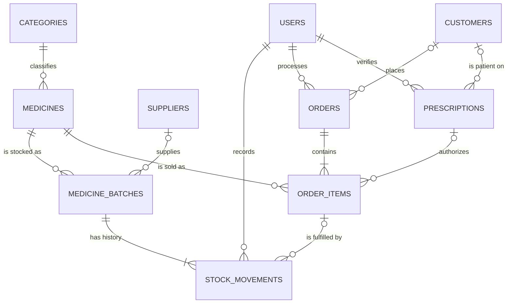
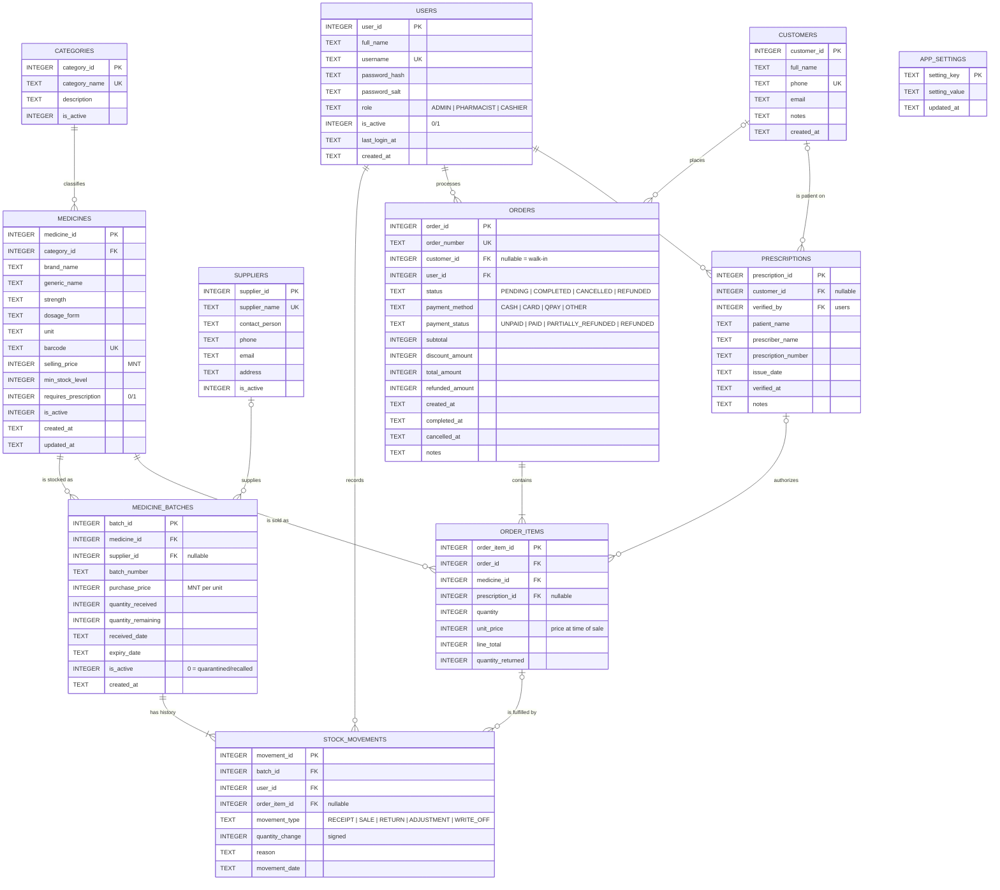

# 2. ERD & Database Design

This chapter has everything you need to draw the ERD: the entities, their attributes and keys, the relationships
with their cardinalities, and the reasoning behind the design. Column-by-column details are in the
[data dictionary](03-data-dictionary.md).

## 2.1 Entity list

The model has **10 business tables** and **1 settings table**.

| # | Table | Kind | What one row represents |
| --- | --- | --- | --- |
| 1 | `users` | Master | A staff account (Admin, Pharmacist or Cashier) |
| 2 | `categories` | Lookup | A medicine group, e.g. *Pain relief* |
| 3 | `medicines` | Master | A sellable product, e.g. *Paracetamol 500 mg tablets, box of 20* |
| 4 | `suppliers` | Master | A wholesaler or distributor |
| 5 | `medicine_batches` | Transaction | One delivery (lot) of one medicine, with its own expiry date and cost |
| 6 | `customers` | Master | A registered or repeat customer (optional on a sale) |
| 7 | `prescriptions` | Transaction | A prescription the pharmacist checked before selling Rx-only items |
| 8 | `orders` | Transaction | One sale / receipt (the header) |
| 9 | `order_items` | Transaction | One medicine line in a sale |
| 10 | `stock_movements` | Log | One signed change to a batch's quantity (receipt, sale, return, adjustment, write-off) |
| 11 | `app_settings` | Configuration | One key/value setting. Not related to other tables |

> The existing prototype also has `query_history` for the built-in SQL editor. It's a developer tool, so it is
> **not** part of the business ERD.

## 2.2 Conceptual ERD (entities and relationships only)

Use this one in your report's introduction or on a slide. Every relationship is one-to-many.

## 2.3 Logical ERD (with attributes and keys)

`PK` = primary key, `FK` = foreign key, `UK` = unique. Money columns are whole MNT. Dates are ISO‑8601 text.

A pre-rendered image of this diagram is in [`erd/pharmacare-erd.png`](erd/pharmacare-erd.png) (and [`.svg`](erd/pharmacare-erd.svg)) for your report. A ready-to-paste version for **dbdiagram.io** is in [`erd/pharmacare.dbml`](erd/pharmacare.dbml). See
[§2.10](#210-how-to-draw-the-erd) for drawing it in other tools.

## 2.4 Relationships and cardinality

How to read crow's-foot notation:

| Symbol at the end of a line | Meaning |
| --- | --- |
| `\|\|` (two bars) | exactly one (mandatory) |
| `\|o` (bar + circle) | zero or one (optional) |
| `\|{` (bar + crow's foot) | one or many |
| `o{` (circle + crow's foot) | zero or many |

| # | Parent (one) | Child (many) | Parent side | Child side | FK column | On delete | Business meaning |
| --- | --- | --- | --- | --- | --- | --- | --- |
| R1 | categories | medicines | exactly 1 | 0..N | `medicines.category_id` NOT NULL | RESTRICT | Every medicine is in one category; a category may be empty |
| R2 | medicines | medicine_batches | exactly 1 | 0..N | `medicine_batches.medicine_id` NOT NULL | RESTRICT | A medicine may have several deliveries; a new medicine has none yet |
| R3 | suppliers | medicine_batches | 0..1 | 0..N | `medicine_batches.supplier_id` NULL | SET NULL | Supplier is optional (e.g. opening stock) |
| R4 | medicine_batches | stock_movements | exactly 1 | 1..N | `stock_movements.batch_id` NOT NULL | RESTRICT | Every batch has at least its RECEIPT movement |
| R5 | users | stock_movements | exactly 1 | 0..N | `stock_movements.user_id` NOT NULL | RESTRICT | Every change is made by a known user |
| R6 | users | orders | exactly 1 | 0..N | `orders.user_id` NOT NULL | RESTRICT | The staff member who rang up the sale |
| R7 | customers | orders | 0..1 | 0..N | `orders.customer_id` NULL | RESTRICT | NULL = walk-in sale |
| R8 | orders | order_items | exactly 1 | 1..N\* | `order_items.order_id` NOT NULL | CASCADE\*\* | A completed order has at least one line |
| R9 | medicines | order_items | exactly 1 | 0..N | `order_items.medicine_id` NOT NULL | RESTRICT | Which product was sold |
| R10 | order_items | stock_movements | 0..1 | 0..N | `stock_movements.order_item_id` NULL | RESTRICT | Which batches a sale line was taken from (FEFO may split a line across batches) and returns against it |
| R11 | customers | prescriptions | 0..1 | 0..N | `prescriptions.customer_id` NULL | SET NULL | Patient may be a registered customer or just a name |
| R12 | users | prescriptions | exactly 1 | 0..N | `prescriptions.verified_by` NOT NULL | RESTRICT | The pharmacist who checked it |
| R13 | prescriptions | order_items | 0..1 | 0..N | `order_items.prescription_id` NULL | RESTRICT | Required (by business rule) only for Rx-only medicines |

\* A `PENDING` order may temporarily have zero lines; the "at least one" rule is enforced when it is completed (BR-05).
\*\* Cascade only matters for deleting a `PENDING` order. Completed orders are never deleted (BR-15).

### Is there a many-to-many relationship?

Yes, two, both resolved through existing tables:

- **Medicines ↔ Suppliers** (a medicine can come from many suppliers, a supplier delivers many medicines) is
  resolved by **`medicine_batches`**.
- **Orders ↔ Medicines** (an order has many medicines, a medicine is in many orders) is resolved by
  **`order_items`**.
- **Order items ↔ Batches** (a line of 15 boxes may take 10 from batch A and 5 from batch B; a batch serves many
  lines) is resolved by **`stock_movements`** of type `SALE`.

These are worth pointing out in a presentation, because they show the M:N relationships were normalised properly.

## 2.5 Why the design looks like this (key decisions)

| Decision | Reason |
| --- | --- |
| **Stock lives on batches, not on medicines** | One medicine arrives in several deliveries with different expiry dates and costs. Only batches can answer "what expires next month?", "which lot is recalled?" and "what did this box cost us?". Total stock for a medicine = sum of its sellable batches. |
| **`stock_movements` is the ledger; `quantity_remaining` is a cached balance** | The movement log is the source of truth and is never edited. `quantity_remaining` is stored too so screens are fast; a new batch starts at 0 and the trigger `trg_movement_apply` adds every movement to it. Invariant: `quantity_remaining = SUM(quantity_change)` for that batch (checked by the `v_integrity_issues` view and the tests). |
| **Sale ↔ batch link is in `stock_movements.order_item_id`, not `order_items.batch_id`** | FEFO can split one line across several batches. One `batch_id` column on the line can't hold that, so each allocated batch gets its own `SALE` movement pointing at the line. |
| **`order_items.unit_price` copied at sale time** | Catalogue prices change. Old receipts and revenue must not change with them. |
| **Money as INTEGER MNT** | No floating-point rounding errors (`0.1 + 0.2 ≠ 0.3`). The tögrög has no subunit in daily use. |
| **Soft delete (`is_active`) instead of DELETE** | Medicines, users, suppliers and categories that appear in history must stay so old orders and movements still make sense. |
| **`customer_id` nullable on orders** | Most pharmacy sales are anonymous walk-ins. |
| **Separate `prescriptions` table** | An Rx-only sale needs proof that a pharmacist saw the prescription. One prescription can cover several lines. |
| **Three roles instead of ADMIN/STAFF** | "Staff – restricted / if authorised" is vague. A Pharmacist vs Cashier split makes the permission rules testable. |
| **`order_number` separate from `order_id`** | Receipts show a readable number like `PC-20261026-0007`; the integer PK stays internal. |
| **`app_settings` key/value table** | Thresholds (expiry warning days, etc.) can change without a schema change. |

## 2.6 Normalisation

The schema is in **Third Normal Form (3NF)**, with a few deliberate, controlled denormalisations.

**1NF – atomic values, no repeating groups.**
Each column holds one value. An order with several medicines doesn't have `medicine1`, `medicine2` columns; each
medicine is a row in `order_items`. (The current prototype stores one product per order. Moving to
`orders` + `order_items` is the main 1NF fix.)

**2NF – no partial dependency on a composite key.**
Every table has a single-column surrogate PK, so partial dependencies can't happen. The natural composite key of
`order_items` would be (`order_id`, `medicine_id`); `quantity` and `unit_price` depend on both, not on one alone.

**3NF – no transitive dependency.**
Medicine data (name, strength) is not repeated in `order_items` or `medicine_batches`, only referenced by
`medicine_id`. Category names live only in `categories`. Supplier contact details live only in `suppliers`.

**Deliberate denormalisations** (and how they stay correct):

| Column | Could be derived from | Why it's stored | Kept correct by |
| --- | --- | --- | --- |
| `medicine_batches.quantity_remaining` | `SUM(stock_movements.quantity_change)` | Fast stock screens and FEFO selection | Changed only by the `trg_movement_apply` trigger; `CHECK (0 ≤ remaining ≤ received)`; invariant test |
| `order_items.line_total` | `quantity × unit_price` | Simple reports | `CHECK (line_total = quantity * unit_price)` |
| `orders.subtotal`, `total_amount` | Sum of lines | Order lists without joins | Calculated in the checkout transaction; `CHECK (total_amount = subtotal - discount_amount)`; test TC-12 |
| `order_items.unit_price` | — (not a denormalisation) | It's a historical fact, not a copy of the current price | Never updated after completion |

## 2.7 Constraints summary

Enable foreign keys on **every** connection (`PRAGMA foreign_keys = ON`); SQLite has them off by default.

| Table | Important constraints |
| --- | --- |
| users | `username` UNIQUE (case-insensitive); `role IN ('ADMIN','PHARMACIST','CASHIER')`; `is_active IN (0,1)` |
| categories | `category_name` UNIQUE (case-insensitive) |
| medicines | `selling_price >= 0`; `min_stock_level >= 0`; `barcode` UNIQUE when not NULL; `requires_prescription IN (0,1)`; `(brand_name, strength, dosage_form, unit)` UNIQUE |
| suppliers | `supplier_name` UNIQUE |
| medicine_batches | `quantity_received > 0`; `quantity_remaining BETWEEN 0 AND quantity_received`; `purchase_price >= 0`; `expiry_date > received_date`; `(medicine_id, supplier_id, batch_number)` UNIQUE |
| customers | `phone` UNIQUE when not NULL |
| prescriptions | `patient_name` NOT NULL; `issue_date <= verified_at` date |
| orders | `order_number` UNIQUE; status and payment enums; `subtotal >= 0`; `0 <= discount_amount <= subtotal`; `total_amount = subtotal - discount_amount`; `0 <= refunded_amount <= total_amount`; `completed_at` NOT NULL when status is `COMPLETED` |
| order_items | `quantity > 0`; `unit_price >= 0`; `line_total = quantity * unit_price`; `0 <= quantity_returned <= quantity`; `(order_id, medicine_id)` UNIQUE (one line per medicine per order) |
| stock_movements | `movement_type` enum; sign must match type (see below); `reason` NOT NULL for `ADJUSTMENT` and `WRITE_OFF`; `order_item_id` NOT NULL for `SALE` and `RETURN` |
| app_settings | `setting_key` is the PK |

**Sign convention for `stock_movements.quantity_change`:**

| movement_type | Sign | Example | Linked order item? | Reason required? |
| --- | --- | --- | --- | --- |
| `RECEIPT` | `> 0`, exactly once per batch, = quantity received | +20 boxes delivered | No | No |
| `SALE` | `< 0` | −3 sold | **Yes** | No |
| `RETURN` | `> 0` | +1 returned by customer | **Yes** | Yes |
| `ADJUSTMENT` | `≠ 0` | −1 missing after a count, +2 found | No | **Yes** |
| `WRITE_OFF` | `< 0` | −12 expired, destroyed | No | **Yes** |

## 2.8 Indexes

Add indexes for searches, sorting and joins that actually happen. Foreign keys aren't indexed automatically in SQLite.

| Table | Index | Used by |
| --- | --- | --- |
| medicines | `brand_name`, `generic_name` (case-insensitive) | Search box |
| medicines | `category_id` | Category filter, FK |
| medicines | `barcode` UNIQUE (partial, where not NULL) | Barcode lookup, uniqueness |
| medicine_batches | `(medicine_id, expiry_date)` | FEFO allocation, stock per medicine |
| medicine_batches | `expiry_date` | Expiry report, dashboard alert |
| medicine_batches | `supplier_id` | FK, supplier report |
| customers | `phone` UNIQUE (partial), `full_name` | Customer search |
| prescriptions | `customer_id`, `verified_by` | FK |
| orders | `created_at`, `(status, completed_at)` | Sales reports by date |
| orders | `customer_id`, `user_id` | Customer history, staff report |
| order_items | `order_id`, `medicine_id`, `prescription_id` | Order detail, best sellers |
| stock_movements | `(batch_id, movement_date)`, `order_item_id`, `user_id` | Batch history, allocations |

Don't index everything: each index slows down inserts and takes space.

## 2.9 Worked examples (use these to check your ERD)

**A. One medicine, two batches.**
*Paracetamol 500 mg, box of 20* is 1 row in `medicines`. Batch `PA-2603` (40 boxes, expires 2027‑03‑31) and batch
`PA-2612` (60 boxes, expires 2027‑12‑31) are 2 rows in `medicine_batches`, each with a `RECEIPT` movement
(+40, +60). Stock on hand = 100.

**B. One sale split across batches (FEFO).**
A customer buys 50 boxes of Paracetamol and 1 bottle of Vitamin C. That makes:
1 `orders` row → 2 `order_items` rows → **3** `SALE` movements: −40 from `PA-2603` (expires first, now 0), −10 from
`PA-2612` (now 50), −1 from the Vitamin C batch. `orders.total_amount` = sum of the two `line_total`s.

**C. Stock count finds a missing box.**
Pharmacist records an `ADJUSTMENT` of −1 on `PA-2612` with reason "Count 2026‑10‑26: 1 box missing".
`quantity_remaining` 50 → 49. The original records stay unchanged.

**D. Expired stock.**
On 2027‑04‑01 the remaining boxes of a batch that expired 2027‑03‑31 can no longer be chosen for sale. The
pharmacist records a `WRITE_OFF` for the remaining quantity with reason "Expired – destroyed". The batch row stays
for traceability.

**E. Partial refund.**
The customer from B returns 1 unopened box. A `RETURN` +1 goes back to the batch it came from (the latest `SALE`
movement for that line). `order_items.quantity_returned` = 1, `orders.refunded_amount` += unit price,
`payment_status` = `PARTIALLY_REFUNDED`. If the box can't be resold, a `WRITE_OFF` −1 follows straight away.

**F. Prescription sale.**
Amoxicillin 500 mg has `requires_prescription = 1`. Before it can go in the cart, a pharmacist records a
`prescriptions` row (patient, prescriber, number, date). The `order_items` line references that `prescription_id`.

## 2.10 How to draw the ERD

| Tool | How |
| --- | --- |
| **dbdiagram.io** (fastest) | Open dbdiagram.io → paste [`erd/pharmacare.dbml`](erd/pharmacare.dbml) → arrange tables → *Export → PNG/PDF*. |
| **Mermaid** | The diagrams above render on GitHub. You can also paste them into mermaid.live and export SVG/PNG. |
| **draw.io / diagrams.net** | *Arrange → Insert → Advanced → SQL* doesn't support crow's feet well. Instead use the *Entity Relation* shape library: one table shape per entity, then connect with *ER One to Many* / *ER Zero to Many* edges following [§2.4](#24-relationships-and-cardinality). |
| **Lucidchart / MySQL Workbench / DBeaver** | Create the tables from the data dictionary and use reverse-engineering to draw the diagram automatically. |

**Layout tip:** put `medicines` in the centre. Put `categories` above it, `medicine_batches` and `suppliers` to the
right, `order_items` and `orders` below, `customers` and `prescriptions` bottom-left, `users` on the far left, and
`stock_movements` bottom-right between batches and order items. That gives you almost no crossing lines.

**Checklist for a good ERD:**
- [ ] All 11 tables, with PK underlined or marked `PK`
- [ ] Every FK marked and drawn as a line to its parent
- [ ] Both ends of every line show cardinality (crow's foot)
- [ ] Optional relationships (R3, R7, R10, R11, R13) drawn with the circle (zero) symbol
- [ ] Relationship names written on the lines
- [ ] A legend for PK / FK / UK and the notation
