# 4. System Diagrams

All diagrams are Mermaid, so GitHub renders them. Paste any of them into mermaid.live to export a PNG/SVG for your report.

## 4.1 Use case diagram

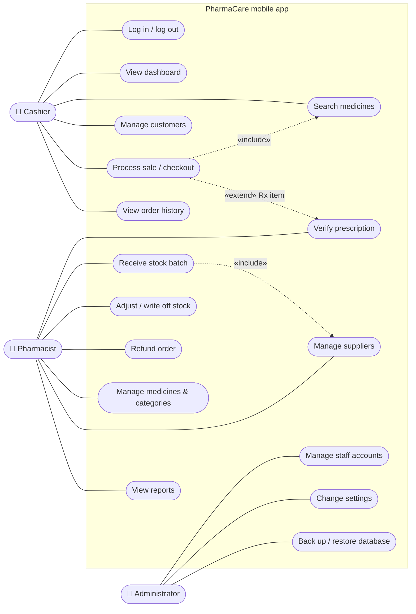

**Generalisation (inheritance) between actors:** a Pharmacist can do everything a Cashier can, and an
Administrator can do everything a Pharmacist can. In a UML tool, draw this as hollow-triangle arrows
*Pharmacist → Cashier* and *Administrator → Pharmacist*; the diagram above links each actor only to the use cases
it adds.

## 4.2 Context diagram (DFD level 0)

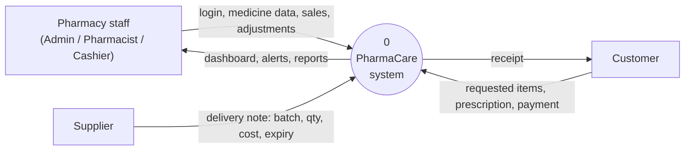

## 4.3 Data flow diagram (DFD level 1)

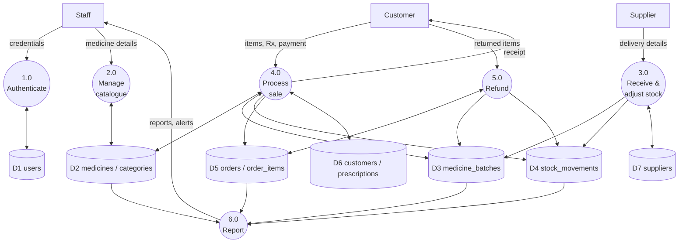

## 4.4 Activity diagrams

### A. Receive a new batch

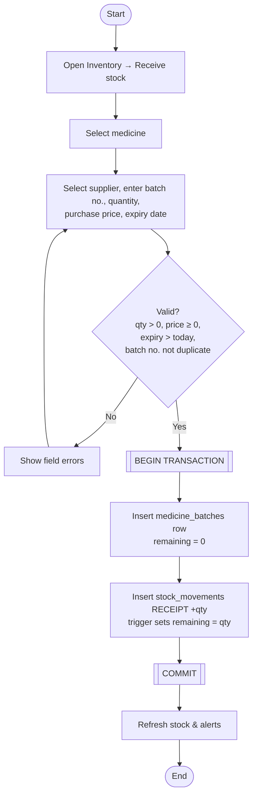

### B. Checkout (process a sale)

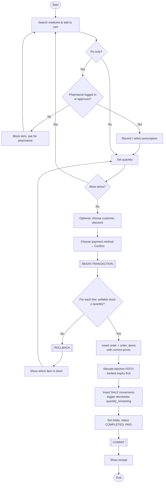

### C. Refund

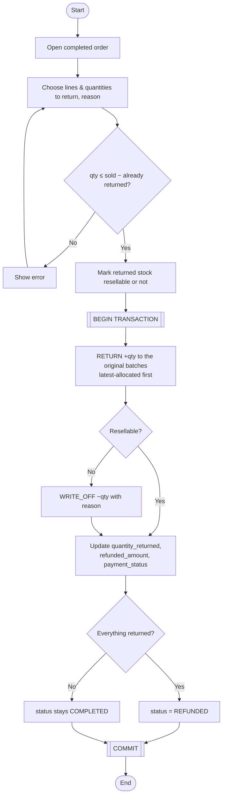

### D. Daily expiry check

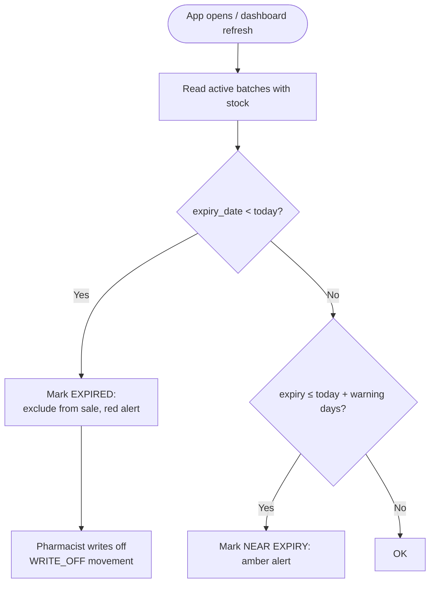

## 4.5 Sequence diagram — checkout

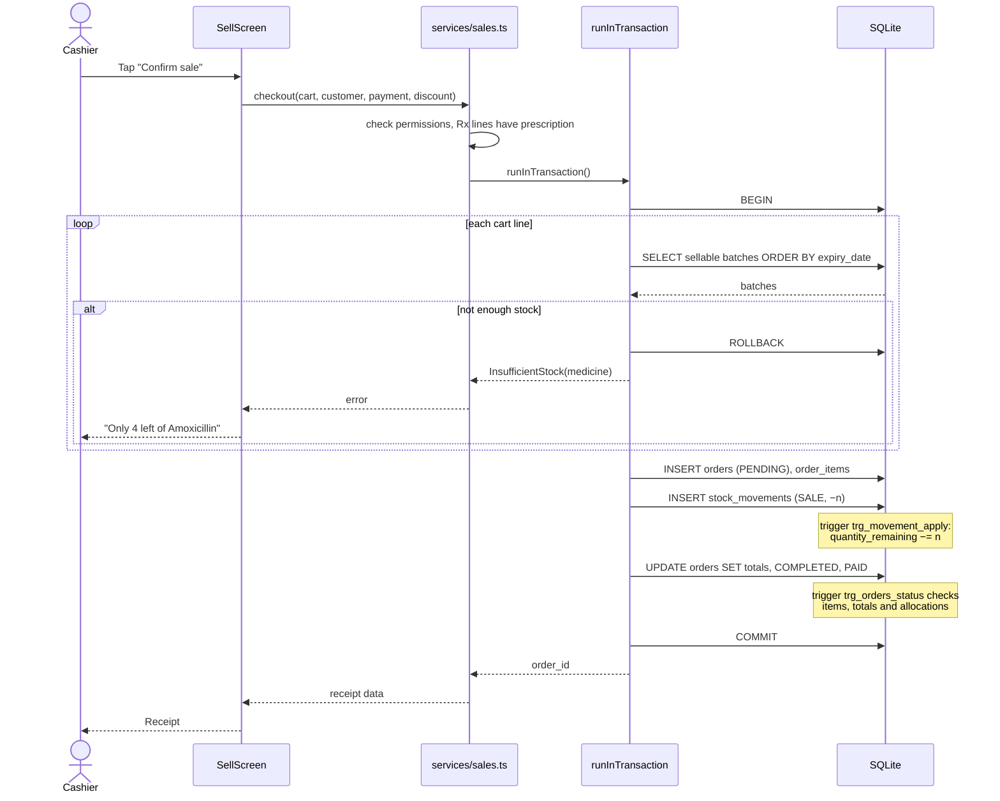

## 4.6 State diagrams

### Order

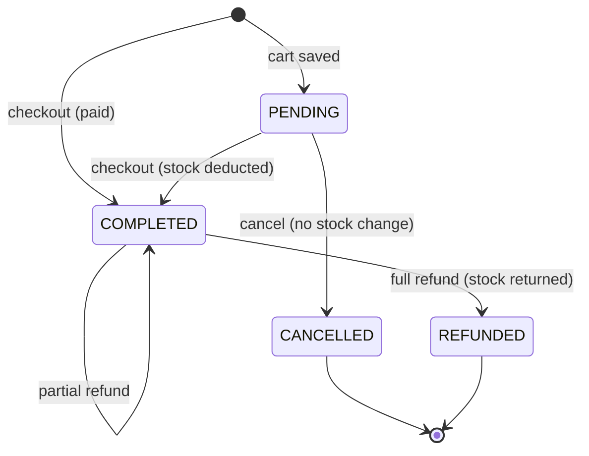

Stock is deducted **only** on the transition into `COMPLETED`, so it can't be deducted twice (BR-07). A `PENDING`
order holds no stock.

### Batch (derived state)

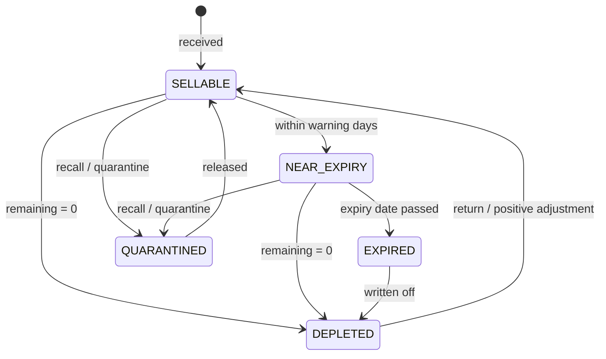

## 4.7 Software architecture

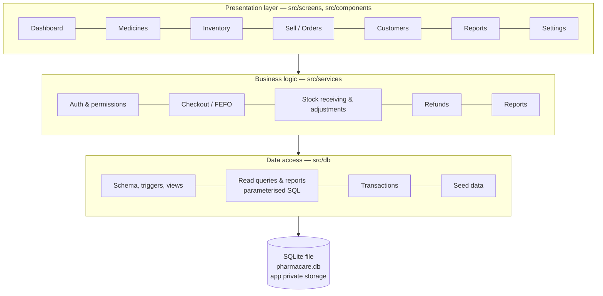

| Layer | Responsibility | Must not |
| --- | --- | --- |
| Presentation | Forms, lists, navigation, showing errors | Write SQL or decide business rules |
| Business logic | Permissions, FEFO, totals, Rx check, state transitions | Know about UI components |
| Data access | SQL, transactions, migrations | Contain UI text |
| SQLite | Constraints as the last line of defence | — |

### Technology choices

| Component | Choice | Notes |
| --- | --- | --- |
| Framework | **Expo (React Native)**, SDK 58 | Already used by this repository |
| Language | TypeScript | |
| Database | **`expo-sqlite`** | Transactions, `PRAGMA user_version` migrations, `backupDatabaseAsync` for backup/restore |
| Navigation | Custom bottom tabs + a "More" menu; move to **Expo Router** if more screens are added | Per project guidelines in `AGENTS.md` |
| Password hashing | PBKDF2-HMAC-SHA256 in plain TypeScript (`src/services/password.ts`) | No native module needed; verified against Node's crypto |
| Backup file sharing (future) | `expo-sharing` + `expo-file-system` / `expo-document-picker` | To copy the backup off the phone; install with `npx expo install` |
| Tests | Node's test runner + built-in `node:sqlite` running the real schema and services (`npm test`) | 22 automated tests |

### Transactions in expo-sqlite

`withExclusiveTransactionAsync` opens a **second connection**, where `PRAGMA foreign_keys` is off (and can't be switched
on inside a transaction), and it isn't available on web. The app therefore uses `withTransactionAsync` on the main
connection and serialises all write operations through one queue (`src/db/transaction.ts`), so two writes can never
interleave.
