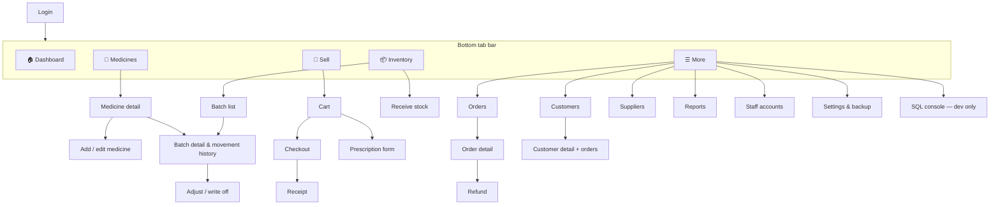

# 5. Mobile UI / UX Design

## 5.1 Navigation map



Five tabs is the most a phone bar holds comfortably; less frequent screens go under **More**.

## 5.2 Screen specifications

### Login
- Pharmacy name/logo, username, password (masked, show/hide toggle), **Log in**.
- Error: "Incorrect username or password" (never says which one was wrong).
- First launch: demo accounts are listed in a hint box (prototype only).

### Dashboard
```
┌──────────────────────────────┐
│ PharmaCare        Bat (Pharm)│
├──────────────────────────────┤
│ ┌──────────┐ ┌──────────┐    │
│ │ Today    │ │ Orders   │    │
│ │ 486,000₮ │ │ 23       │    │
│ └──────────┘ └──────────┘    │
│ ┌──────────┐ ┌──────────┐    │
│ │ Low stock│ │ Expiring │    │
│ │ 5  ⚠     │ │ 3  ⏱     │    │
│ └──────────┘ └──────────┘    │
│ ⛔ 2 batches EXPIRED → review │
│ Low stock                    │
│  Amoxicillin 500mg   4 / 20  │
│  Vitamin C 1000mg    6 / 15  │
│ Recent sales                 │
│  PC-…-0023  45,000₮  10:42   │
├──────────────────────────────┤
│ 🏠   💊   🛒   📦   ☰        │
└──────────────────────────────┘
```
Tapping a tile opens the filtered list (e.g. low-stock medicines).

### Medicines (catalogue)
- Search bar (brand, generic name, barcode) + filter chips: category, *Rx only*, *Low stock*, *Out of stock*, *Inactive*.
- Row: brand + strength, generic name, price, stock badge (green / amber "low" / red "out"), **Rx** badge.
- **+ Add** (Admin, Pharmacist). Detail screen shows batches, total stock, last sold.

### Sell (point of sale)
```
┌──────────────────────────────┐
│ 🔍 Search medicine…          │
│ Panadol 500mg     2,500₮  [+]│
│ Amoxil 500mg Rx   8,900₮  [+]│
├──── Cart (3) ────────────────┤
│ Panadol 500mg   [-] 2 [+]  5,000│
│ Vit C 1000mg    [-] 1 [+] 12,000│
│ Customer: Walk-in  ▾         │
│ Discount: 0₮                 │
│ TOTAL               17,000₮  │
│ [ Save ]   [  Checkout  ]    │
└──────────────────────────────┘
```
- `+` disabled when no sellable stock; quantity can't exceed sellable stock.
- Rx item opens the prescription form first (pharmacist only).
- Checkout sheet: payment method (Cash / Card / QPay / Other) → **Confirm**.
- Receipt: pharmacy name, order number, date, cashier, lines, total, payment method, footer. **New sale** button.

### Inventory
- Segments: **Batches** / **Movement log**; filter chips: All, Sellable, Near expiry, Expired, Quarantined, Empty.
- Row: medicine, batch no., remaining / received, expiry date with coloured chip, supplier.
- **Receive stock** (form from activity diagram A).
- Batch detail: movement timeline (+40 RECEIPT, −3 SALE PC-…-0007, −1 ADJUSTMENT "count"), buttons **Adjust**, **Write off**, **Quarantine**.

### Orders
- Filters: date range, status, staff. Row: order number, time, customer, items count, total, status chip.
- Detail: lines with batches used, payment, totals, refunds. **Refund** (Pharmacist/Admin), **Cancel** (pending only), **Resume** (pending only).

### Customers
- Search by name/phone, **+ Add**. Detail: contact info, order count, total spent, order list.

### Reports
- Report picker + date range chips (Today, 7, 30, 90 days, 1 year) (see [chapter 7](07-reports.md)). Each report shows a table and a short summary line.

### Settings & More
- Settings: pharmacy name, expiry warning days, default min stock, auto-lock.
- Backup: **Create backup** (saves/shares a `.db` file with date in the name), **Restore** (pick file → confirm → app restarts).
- Staff accounts (Admin): list, add, change role, deactivate, reset password.
- About: version, schema version, data counts.

## 5.3 Design system

| Element | Guideline |
| --- | --- |
| Colours | Primary teal/green (health), neutral greys; status colours: green = OK, amber = low / near expiry, red = out / expired, blue = info |
| Typography | System font; 22 pt titles, 16 pt body, 13 pt captions; numbers right-aligned with tabular figures |
| Touch | Minimum 44 × 44 pt targets, 8 pt spacing grid, primary action at bottom within thumb reach |
| Feedback | Toast for success, inline red text for field errors, confirmation dialog for destructive actions |
| Empty states | Explain and offer the action, e.g. "No batches yet — **Receive stock**" |
| Accessibility | Labels on icon buttons, don't use colour alone (add text: "Expired"), support system font scaling and dark mode |
| Money | `12,500₮`; never show decimals |
| Dates | `2027-03-31` in tables, "in 23 days" / "3 days ago" as helper text |
